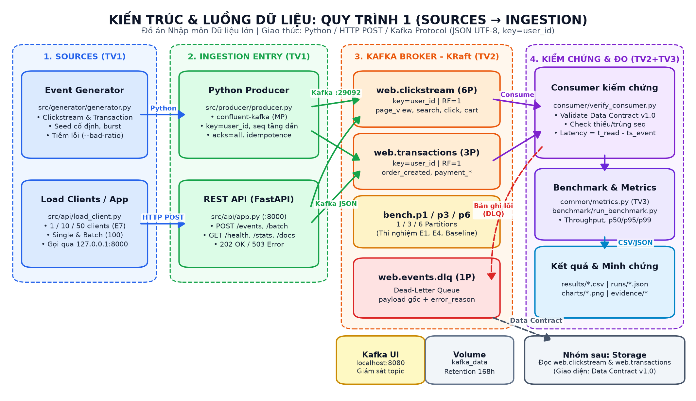

# Đồ án Nhập môn Dữ liệu lớn: Quy trình 1 (`Sources → Ingestion`)

Hệ thống thu thập dữ liệu hành vi người dùng (`clickstream`) và giao dịch (`transaction`) từ website thương mại điện tử giả lập đưa vào **Apache Kafka** theo thời gian thực, kèm **REST API (FastAPI)**, **Consumer kiểm chứng** (schema, `seq` thiếu/trùng, Dead-Letter Queue) và bộ **Benchmark E1–E7 + Baseline**.

| Mã | Vai trò chính | Phụ trách chính |
|---|---|---|
| **TV1** | Nguồn dữ liệu, Producer & REST API | Data contract, `src/generator`, `src/producer`, `src/api`, `benchmark/run_tv1.py`, E2/E3/E7 |
| **TV2** | Hạ tầng Kafka & Consumer kiểm chứng | `docker-compose.yml`, `infra/create_topics.py`, `consumer/verify_consumer.py`, `docs/infra.md` |
| **TV3** | Thực nghiệm, đo đạc & minh chứng | `common/metrics.py`, `docs/experiment_plan.md`, `benchmark/run_benchmark.py`, Baseline & E1/E4/E5/E6, biểu đồ, sơ đồ, tổng hợp & clean run |

> Chi tiết hạ tầng TV2 xem tại [docs/infra.md](docs/infra.md); chuẩn dữ liệu TV1 xem tại [docs/data_contract.md](docs/data_contract.md).

---

## 1. Kiến trúc và luồng dữ liệu



* **File nguồn sơ đồ có thể chỉnh sửa (draw.io):** [`docs/diagrams/architecture.drawio`](docs/diagrams/architecture.drawio)
* **Luồng chính:** `Generator / Client` → `Python Producer` hoặc `REST API (FastAPI)` → `Apache Kafka` (`web.clickstream` 6P, `web.transactions` 3P) → `Consumer kiểm chứng` → `results/*.csv`, `charts/*.png`.
* **Luồng lỗi (DLQ):** `Consumer kiểm chứng` phát hiện bản ghi vi phạm Data Contract v1.0 → đẩy sang `web.events.dlq` (1P) kèm `error_reason`.
* **Giao diện với nhóm sau (`Ingestion → Storage`):** Đọc trực tiếp từ `web.clickstream` và `web.transactions` theo [`docs/data_contract.md`](docs/data_contract.md).

---

## 2. Cấu trúc thư mục

```text
tv3-experiments-evidence/
├── README.md                        # Hướng dẫn tổng & tái lập (TV3)
├── README_TV1.md                    # Tài liệu chi tiết phần TV1
├── requirements.txt                 # Thư viện Python đã ghim phiên bản
├── docker-compose.yml               # Kafka KRaft (1 broker, :29092) + Kafka UI (:8080) (TV2)
├── docker-compose.override.yml      # Fix phân quyền volume Docker trên Windows (TV3)
├── common/
│   ├── validate.py                  # Kiểm tra sự kiện theo Data Contract (TV1)
│   └── metrics.py                   # Tính throughput, p50/p95/p99, mean/std (TV3)
├── schemas/                         # JSON Schema clickstream & transaction (TV1)
├── src/                             # generator, producer, REST API (TV1)
├── infra/                           # Script tạo 6 topic idempotent (TV2)
├── consumer/                        # verify_consumer.py, compare_e6.py, 40 unit tests (TV2)
├── result/                          # export_experiment_csv.py (TV2)
├── benchmark/
│   ├── run_tv1.py, plot_timeline.py # Runner E2, E3, E7 của TV1
│   ├── config.json                  # Cấu hình ma trận thực nghiệm (TV3)
│   ├── run_benchmark.py             # Runner chuẩn chạy Baseline, E1, E4, E5, E6 (TV3)
│   ├── generate_charts.py           # Vẽ biểu đồ PNG & xuất summary_E1_E7.csv (TV3)
│   └── render_diagram_png.py        # Xuất ảnh sơ đồ kiến trúc PNG (TV3)
├── tests/                           # Unit test cho common/metrics.py (TV3)
├── data/sample/                     # 1.000 sự kiện mẫu (TV1)
├── results/                         # CSV chuẩn Baseline, E1..E7, summary_E1_E7.csv
├── charts/                          # Biểu đồ PNG cho Baseline, E1, E2, E3, E4, E7
├── evidence/                        # Ảnh Kafka UI, Swagger, terminal & log (xem evidence/INDEX.md)
└── docs/                            # data_contract, infra, experiment_plan, Ket_qua_tong_hop_E1_E7, diagrams
```

---

## 3. Yêu cầu môi trường & Cài đặt từ đầu (Clean Run)

* **Hệ điều hành:** Windows 10/11 64-bit (hoặc Linux/macOS), RAM ≥ 8 GB (cấp Docker ≥ 4 GB).
* **Phần mềm:** Python ≥ 3.10 (đã kiểm chứng trên Python 3.13.2), Docker Desktop (WSL2), Git.

### Bước 1: Tạo môi trường ảo và cài thư viện
```powershell
python -m venv .venv
Set-ExecutionPolicy -Scope Process -ExecutionPolicy RemoteSigned
.\.venv\Scripts\Activate.ps1
pip install -r requirements.txt
```

### Bước 2: Khởi động Kafka + Kafka UI và tạo Topic
```powershell
docker compose up -d
# Đợi container kafka chuyển sang trạng thái (healthy)
python infra/create_topics.py --show-reasons
```
* Truy cập **Kafka UI:** `http://localhost:8080`
* Kết nối Kafka từ host Windows: `localhost:29092`

### Bước 3: Chạy kiểm thử đơn vị (không cần đợi thí nghiệm nặng)
```powershell
python -m unittest tests/test_metrics.py -v
python -m unittest discover -s consumer -v
python -m src.generator.selftest
python -m src.generator.schema_check
python -m src.api.selftest
```

### Bước 4: Chạy thí nghiệm & sinh biểu đồ
```powershell
# Chạy toàn bộ bộ thực nghiệm TV3 (Baseline, E1, E4, E5, E6)
python -m benchmark.run_benchmark --only BASELINE E1 E4 E5 E6

# Hoặc chạy riêng E4 (độ trễ end-to-end theo tải)
python -m benchmark.run_benchmark --only E4

# Tổng hợp kết quả E1–E7 và vẽ toàn bộ biểu đồ PNG vào charts/
python -m benchmark.generate_charts
```

*(Lưu ý khi chạy thủ công Producer/API của TV1 với hạ tầng Docker TV2: truyền `--bootstrap localhost:29092` cho `src.producer.producer` hoặc đặt `$env:KAFKA_BOOTSTRAP="localhost:29092"` trước khi chạy `uvicorn src.api.app:app --port 8000`)*.

---

## 4. Nhật ký Clean Run (TV3 kiểm chứng thực tế)

| Hạng mục kiểm chứng | Kết quả quan sát | Thời gian ước lượng |
|---|---|---|
| Cài `.venv` + `pip install -r requirements.txt` | Thành công (Python 3.13.2) | ~1–2 phút |
| `docker compose up -d` (sau khi đã pull image) | `kafka` Healthy + `kafka-ui` Started | ~15 giây |
| `python infra/create_topics.py` | 6/6 topic (`web.*`, `bench.*`) | ~2 giây |
| Bộ unit tests (`metrics`, `consumer`, `generator`, `schema`, `api`) | **100% PASS** (4 + 40 + 3 selftests) | ~5 giây |
| Toàn bộ Benchmark (`BASELINE, E1, E4, E5, E6`) | Đầy đủ CSV & log, `missing=0, dup=0` | ~9 phút |

---

## 5. Tài liệu chi tiết & Đóng góp

* Kế hoạch & chuẩn đo đạc: [`docs/experiment_plan.md`](docs/experiment_plan.md)
* Tổng hợp phân tích E1–E7 & Baseline: [`docs/Ket_qua_tong_hop_E1_E7.md`](docs/Ket_qua_tong_hop_E1_E7.md)
* Mục lục minh chứng: [`evidence/INDEX.md`](evidence/INDEX.md)
* Bảng đóng góp thành viên & sử dụng AI: [`docs/contributions.md`](docs/contributions.md), [`docs/ai_usage.md`](docs/ai_usage.md)
